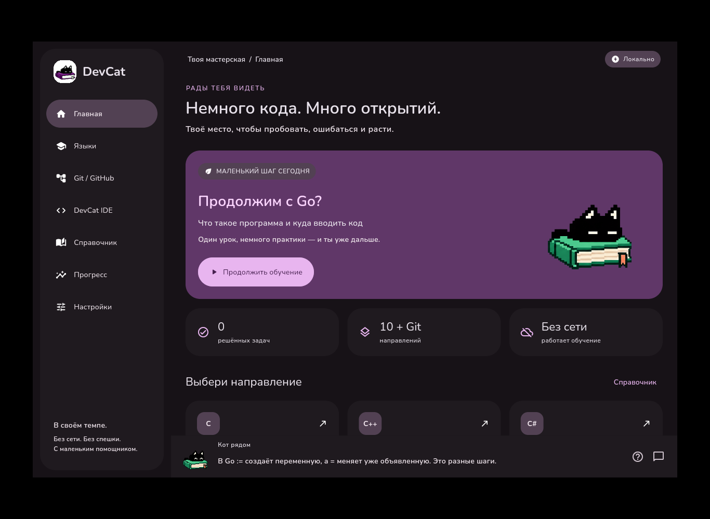
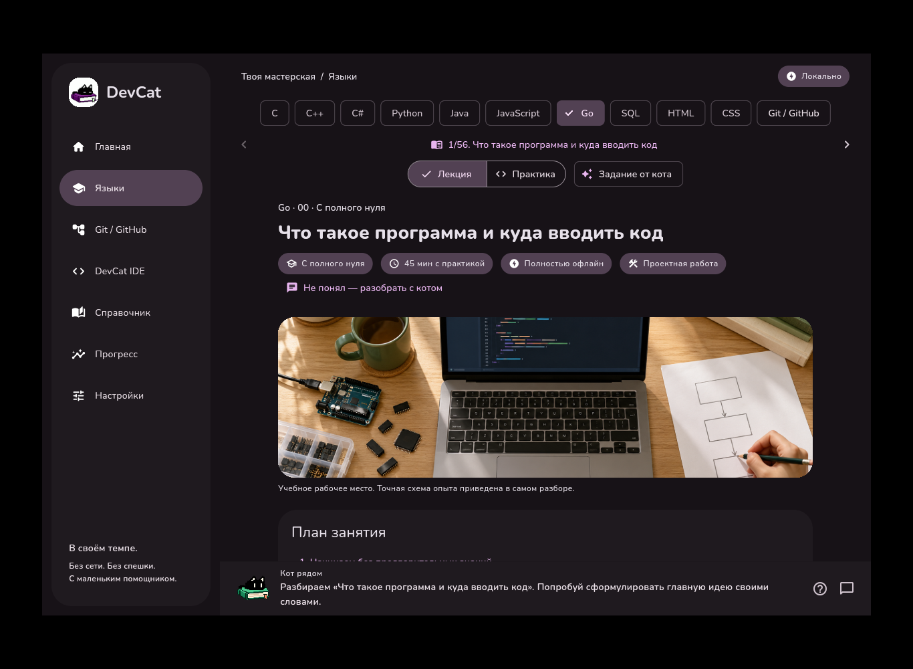

<p align="center"></p>
<h1 align="center">DevCat</h1>
<p align="center">Локальная мастерская программирования. Учимся с полного нуля, по одному понятному шагу.</p>

[Скачать DevCat 0.4.0](https://github.com/PANDORA615/DevCat-/releases/tag/v0.4.0) · [Учебники одним архивом](https://github.com/PANDORA615/DevCat-/releases/download/v0.4.0/DevCat-0.4.0-lectures.zip) · [Программа](docs/CURRICULUM.md) · [Проверки](docs/VALIDATION.md)


DevCat работает на Linux, Windows, macOS и Android. Учебные материалы, иллюстрации, задания, проекты и прогресс доступны без аккаунта и обязательного сервера. Для работы с самим GitHub нужен интернет.




## Обучение с нуля

**C, C++, C#, Python, Java, JavaScript, Go и SQL — по 56 занятий. HTML и CSS — по 24. Ещё 20 занятий посвящены Git и GitHub: всего 516.** В каждом из первых восьми направлений курс начинается с восьми вводных опытов: где исходник, ввод и результат; запуск; числа и текст; переменная; расчёт покупки; чтение числа; условие; цикл. Термины объясняются до перехода к общей модели.

Ученик сначала запускает маленький полный пример, сопоставляет действия и результат, изменяет один параметр, предсказывает ответ и только затем пишет самостоятельный вариант. Дальше изучаются функции, коллекции, файлы, ошибки, тесты, особенности языка, проекты и сложные алгоритмы. Схемы нумерации исходника явно отделены от трассировки выполнения. Иллюстрации можно увеличивать.

**125 лабораторных проверяются настоящим запуском кода.** Остальные работы имеют условия и критерии самостоятельной проверки. Разборы префиксных сумм, окна, Кадане, поиска по ответу, DP, LIS, BFS и Дейкстры включают полные программы, ограничения и примеры результатов. SQL содержит реальные исходные, промежуточные и итоговые таблицы. Умение решать самостоятельные задачи нужно проверять выполненными проектами; счётчик прочитанных страниц его не измеряет.

[Читать книги в репозитории](docs/textbooks/README.md). В архиве находятся 11 HTML-книг, 11 Markdown-версий, шрифты с лицензиями и иллюстрации. Распакуйте целиком и откройте `index.html`. HTML можно печатать в PDF. JavaScript и сетевые ресурсы для чтения не нужны.

## Компаньон

Тот же чёрный пиксельный кот лежит на учебнике. Новая иконка подготовлена для всех платформ. На главной кот имеет прозрачный фон. Шесть эмоций и парные кадры рта сопровождают реплики; reduced motion отключает разговорную анимацию. Кот говорит на всех вкладках, учитывает контекст, приостанавливается в фоне и поверх диалогов. Есть история и настройка частоты.

Все 14 звуков владельца сохранены. Добавлены шесть тихих оригинальных вариантов «тык» и шесть коротких голосовых вариантов. Голос и эффекты регулируются отдельно; голосовые сигналы не являются синтезом произнесённых слов.

**«Разберём вместе»** — офлайн-помощник по материалам курса: поиск вопроса, разбор исходника, пример, объяснение ошибки и уточнения в контексте выбранного урока. Источник указан в ответе, история сохраняется. Это поиск и авторские объяснения, **не генеративная LLM**. Вопрос вне материалов требует уточнения; произвольный анализ пользовательской программы не обещается.

## Практика и IDE

- Многофайловые проекты, дерево и вкладки, подсветка, undo, folding, поиск/замена, сохранение, импорт/экспорт проектов и клавиатурные команды.
- C/C++/C#/Java/Go компилируются локально; Python и Node.js исполняют реальные модули. На ПК нужны системные инструменты. На Android все восемь сред находятся внутри APK и не загружаются после установки.
- **HTML/CSS:** `index.html`, `style.css`, подсветка и сохранение файлов; настоящий внешний браузер получает страницу с локального адреса `127.0.0.1`. После сохранения обновите страницу. Внешние зависимости блокируются. Сервер работает, пока приложение открыто; телефон не получает постоянный фоновый хостинг.
- **SQLite IDE:** постоянная база проекта, до 100 команд в одном соединении, транзакции и внешние ключи. Незавершённая явная транзакция откатывается. Без `BEGIN` предыдущие autocommit-команды могут сохраниться при ошибке следующей.
- **Git:** настоящая лаборатория на ПК с редактором README, status/add/commit/log/diff/branch/switch/merge/show. **GitHub:** пошаговые браузерные действия на ПК и телефоне в своём аккаунте, со снимками настоящих публичных страниц. DevCat не принимает пароль GitHub, автоматически не публикует чужие изменения и не создаёт PR.

Код запускается с правами пользователя после согласия. Таймауты и лимиты вывода предусмотрены, полной песочницы для недоверенного кода нет. Проекты ограничены 40 текстовыми файлами / 180 КБ; произвольные бинарные файлы и package manager UI пока не поддерживаются.

## Скачать и установить

[Релиз 0.4.0](https://github.com/PANDORA615/DevCat-/releases/tag/v0.4.0) содержит пакеты и `SHA256SUMS`.

| Платформа | Пакеты |
|---|---|
| Ubuntu / Debian / Mint / Pop!_OS, x86_64 | DEB |
| Fedora / openSUSE, x86_64 | отдельные RPM |
| Arch / Manjaro, x86_64 | pkg.tar.zst |
| Другие Linux с glibc ≥2.35, x86_64 | AppImage / tar.gz |
| Windows 10/11, x64 | setup.exe / portable ZIP |
| macOS, Intel и Apple Silicon | universal DMG / ZIP |
| Android 7+, ARM64 / ARMv7 / x86_64 | **один универсальный APK** |

Android APK содержит все три среды и потому большой; распаковывается только подходящая архитектура. Нужны место для APK, установки и примерно 1,6–1,9 ГБ для среды сверх установленного приложения. Подпись постоянная; versionCode 5005 выше старых split APK, обновление сохраняет данные. AAB и отдельные ABI APK в этом выпуске не распространяются.

Linux требует GTK 3, libsecret и GStreamer, включая AppImage. На Ubuntu: `sudo apt install libgtk-3-0 libsecret-1-0 libgstreamer1.0-0 libgstreamer-plugins-base1.0-0 gstreamer1.0-plugins-good`. AppImage без FUSE запускается с `--appimage-extract-and-run`. Windows может требовать официальный Visual C++ Redistributable 2015–2022 x64. Authenticode и Apple Developer ID/notarization не настроены. [Матрица поддержки](docs/SUPPORT.md).

## Продолжить на другом устройстве

Подключите устройства к одной Wi-Fi сети. В настройках одного выберите **Синхронизация рядом → Показать QR**, на телефоне отсканируйте или на другом ПК вставьте код. Временное соединение на пять минут использует AES-256-GCM. Объединяются прогресс, позиции, ответы, черновики и исходники проектов. Повторяйте соединение при переходе между устройствами; фонового облачного аккаунта нет. Произвольные созданные программой файлы и SQLite-базы не переносятся. Сохраняются версии разных устройств. Дополнительно доступны экспорт/импорт и личный HTTPS WebDAV. [Приватность](docs/PRIVACY.md).

## Разработка

```bash
git clone https://github.com/PANDORA615/DevCat-.git
cd DevCat-/apps/devcat_flutter
flutter pub get --enforce-lockfile
flutter analyze
flutter test --reporter expanded --concurrency=2
flutter run -d linux
```

Flutter 3.47.8 / Dart 3.13.7, зависимости закреплены. CI проверяет формат, анализатор, реальные программы, генерацию контента и пакеты всех платформ. [Сборка и подпись](docs/RELEASING.md), [среда Android](docs/ANDROID_RUNTIME.md), [план и ограничения](IMPLEMENTATION_PLAN.md).

Код — MIT. Иконка и атлас эмоций сгенерированы по каноническому коту владельца. Учебные схемы — технические иллюстрации, веб-снимки получены Chromium, GitHub-снимки показывают публичный репозиторий. Исходные звуки предоставлены владельцем; новые звуки созданы для DevCat. Nunito и JetBrains Mono — SIL OFL. Соответствующие исходники GPL-компонентов Android публикуются вместе с релизом. [Сторонние лицензии](docs/THIRD_PARTY_NOTICES.md).
