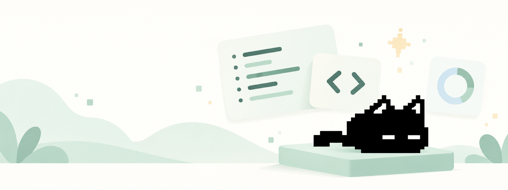

<p align="center"></p>
<h1 align="center">DevCat</h1>
<p align="center">Немного кода. Много открытий.<br>Локальная мастерская программирования с пиксельным котом.</p>
<p align="center"><a href="https://github.com/PANDORA615/DevCat-/releases">Скачать приложения</a> · <a href="docs/SUPPORT.md">Поддержка платформ</a> · <a href="IMPLEMENTATION_PLAN.md">План реализации</a></p>



DevCat 0.1 — первый рабочий срез большого [ТЗ](docs/SPECIFICATION.ru.md). Уроки, генератор заданий, редактор и прогресс работают на устройстве без аккаунта. Облачный ИИ и обязательный backend не нужны. Русский интерфейс, Flutter Material 3, спокойные цвета, плавные переходы и собственные тихие звуки.

## Что работает

- **Восемь языков:** C, C++, C#, Python, Java, JavaScript, Go, SQL. По два вводных урока с объяснениями, примерами, ошибками и ссылками на источники. Это вводные модули, а не полные профессиональные курсы.
- **Задания от кота:** локальный параметрический генератор с тремя подсказками, эталоном по запросу и граничными тестами. Без запросов к LLM. Git/GitHub исключён из генератора.
- **Настоящая проверка:** на ПК системные компиляторы выполняют программу, результат сравнивается с контрактом. SQLite встроен и проверяет запросы на двух наборах данных. Код не оценивается по совпадению с эталоном.
- **Отдельный Git:** теория и desktop-лаборатория с настоящими init/add/commit/log и проверкой коммита с README. Публикация на GitHub из приложения ещё не реализована.
- **Редактор одного файла:** подсветка синтаксиса, номера строк, folding, undo, автосохранение, импорт и экспорт. На Android код и результат разделены для удобной работы с клавиатурой.
- **Прогресс между устройствами:** добровольная ручная синхронизация через личный HTTPS WebDAV, защита ETag и объединение попыток. Разные черновики сохраняются. Есть экспорт/импорт JSON.
- **Настройки:** системная/светлая/тёмная тема, палитры, свой HEX-цвет, Material You при поддержке ОС, контраст, reduced motion, размер шрифта, кот, звук и громкость.

**На Android локально исполняется SQLite.** Для остальных языков доступны офлайн-материалы, генератор и редактор, но компиляторы не входят в APK. Полностью локальный запуск всех восьми языков на телефоне пока не реализован.

## Скачать и установить

Готовые файлы находятся в [GitHub Releases](https://github.com/PANDORA615/DevCat-/releases). Скачивайте пакет своей ОС; проверяйте `SHA256SUMS`.

| Платформа | Файлы |
|---|---|
| Ubuntu / Debian / Mint / Pop!_OS | `.deb` · x86_64 |
| Fedora / openSUSE / RPM-системы | `.rpm` · x86_64 |
| Arch / Manjaro | `.pkg.tar.zst` · x86_64 |
| Другие Linux с glibc ≥ 2.35 | `.AppImage` или `.tar.gz` · x86_64 |
| Windows 10 / 11 | `setup.exe` или portable `.zip` · x64 |
| macOS | `.dmg` или `.zip`; архитектура указана в релизе |
| Android | universal APK или APK для arm64-v8a / armeabi-v7a / x86_64; AAB для магазина |

```bash
# Debian / Ubuntu 22.04+
sudo apt install ./DevCat-0.1.0-linux-amd64.deb
# Fedora
sudo dnf install ./DevCat-0.1.0-linux-x86_64.rpm
# openSUSE
sudo zypper install ./DevCat-0.1.0-linux-x86_64.rpm
# Arch / Manjaro
sudo pacman -U ./DevCat-0.1.0-linux-x86_64.pkg.tar.zst
# AppImage (GTK 3 / libsecret / GStreamer должны быть установлены)
chmod +x DevCat-0.1.0-linux-x86_64.AppImage
./DevCat-0.1.0-linux-x86_64.AppImage
# Если в системе нет FUSE:
./DevCat-0.1.0-linux-x86_64.AppImage --appimage-extract-and-run
```

Для AppImage/tar.gz на Ubuntu: `sudo apt install libgtk-3-0 libsecret-1-0 libgstreamer1.0-0 libgstreamer-plugins-base1.0-0 gstreamer1.0-plugins-good`. На Fedora: `sudo dnf install gtk3 libsecret gstreamer1 gstreamer1-plugins-base gstreamer1-plugins-good`. На Arch: `sudo pacman -S gtk3 libsecret gstreamer gst-plugins-base-libs gst-plugins-good`.

Windows: запускайте `setup.exe` либо распакуйте ZIP целиком и откройте `devcat.exe`; папки `data` и DLL должны оставаться рядом. При необходимости установите официальный Microsoft Visual C++ Redistributable 2015–2022 x64. macOS: перенесите приложение из DMG в Applications. Desktop-сертификатов владельца нет: Windows может показать SmartScreen, macOS — Gatekeeper. AAB не устанавливается напрямую; для телефона используйте APK.

## Продолжить на телефоне

1. Создайте папку `DevCat` в личном WebDAV/Nextcloud и пароль приложения с доступом к ней.
2. На ПК откройте **Настройки → Продолжить на другом устройстве**. Введите HTTPS URL существующей папки, имя пользователя и пароль. Нажмите «Синхронизировать».
3. Введите те же данные на телефоне и выполните синхронизацию. Позиция курса и черновики загрузятся; нажмите «Продолжить обучение».
4. Перед сменой устройства повторяйте синхронизацию на обоих. Она ручная. Если оба устройства редактировали задачу, версии доступны по значку устройств в редакторе.

Пример URL Nextcloud: `https://cloud.example/remote.php/dav/files/USER/DevCat/`. Сервер должен поддерживать сильный ETag и условные PUT. Администратор вашего WebDAV видит данные: E2EE пока нет. Пароли не входят в экспорт; по выбору сохраняются в системном keychain. [Подробности приватности](docs/PRIVACY.md).

## Локальные компиляторы

На ПК установите нужные инструменты и добавьте их в PATH. **Настройки → Среда исполнения** показывает реальные версии.

| Направление | Инструмент |
|---|---|
| C / C++ | Clang или GCC, C17 / C++20 |
| C# | .NET 8 SDK |
| Python | CPython 3 |
| Java | JDK 21 с java и javac |
| JavaScript | Node.js LTS |
| Go | Go 1.22+ |
| SQL | SQLite встроен |
| Git | Git 2 |

Код запускается только после согласия, с правами пользователя. Это **не песочница для недоверенного кода**. Есть таймауты и лимит вывода, но нет полной изоляции файлов, памяти или дерева процессов. Toolchain не входят в установщики. Никакой автоматической установки зависимостей из интернета.

## Разработка

```bash
git clone https://github.com/PANDORA615/DevCat-.git
cd DevCat-/apps/devcat_flutter
# Flutter 3.47.8 / Dart 3.13.7
flutter pub get --enforce-lockfile
flutter analyze
flutter test --reporter expanded
flutter run -d linux   # или windows / macos / Android device id
```

Linux build-зависимости: clang, cmake, ninja-build, pkg-config, libgtk-3-dev, liblzma-dev, libsecret-1-dev, libgstreamer1.0-dev, libgstreamer-plugins-base1.0-dev. Тесты runner дополнительно используют доступные Python/Node/Clang/Go/JDK/.NET; CI устанавливает все восемь сред. Для HTTPS integration test нужен openssl.

```bash
flutter build linux --release
flutter build windows --release    # на Windows
flutter build macos --release      # на macOS
flutter build apk --release --split-per-abi
flutter build appbundle --release
```

[GitHub Actions](.github/workflows/build.yml) проверяет форматирование, анализатор, тесты, контент и собирает ОС-пакеты. Android inputs без настроенных owner signing secrets **не публикуются как готовый релиз**: [инструкция подписи](docs/RELEASING.md).

```text
apps/devcat_flutter/   Flutter-клиент, локальный runner, тесты
content/              авторские вводные модули и источники
packages/             схема контента, токены, бренд
scripts/              генерация ресурсов и упаковка
.github/workflows/    проверки и сборки четырёх платформ
docs/                 ТЗ, поддержка, архитектура, приватность, проверка
```

## Что ещё предстоит

`NOT_IMPLEMENTED`: полные продвинутые курсы; LSP/DAP/PTY; многофайловые проекты и сборки; управление пакетами; GitHub OAuth, SSH/SFTP и PR; серверный изолированный runner; фоновые аккаунтные sync; PostgreSQL/Redis/S3; ручной редактор каждого токена темы; набор всех кадров кота. Сейчас кот использует временный idle из канонического исходника; концепт-спрайт из вложения не выдаётся за рабочую анимацию. Плавность 60 fps на целевых устройствах ещё требует измерений.

Статус каждого направления и критерии завершения — в [плане](IMPLEMENTATION_PLAN.md). Ограничения desktop/Android — в [матрице поддержки](docs/SUPPORT.md). Проверки и скриншоты — в [отчёте](docs/VALIDATION.md). Архитектурные решения и риски — в [ADR](docs/ARCHITECTURE.md).

Код и собственные звуки — MIT. Исходный кот и концепты предоставлены пользователем; иконка и иллюстрация созданы по его референсу. Сторонние зависимости сохраняют свои лицензии; Flutter также включает их в реестр лицензий приложения.
