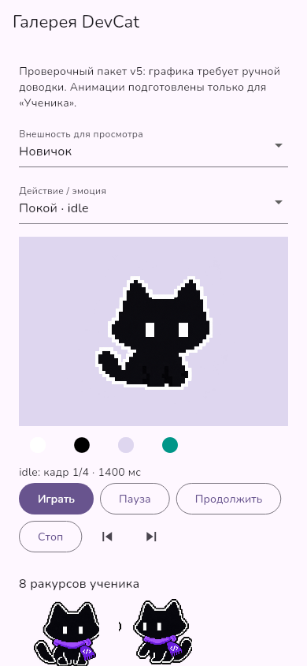
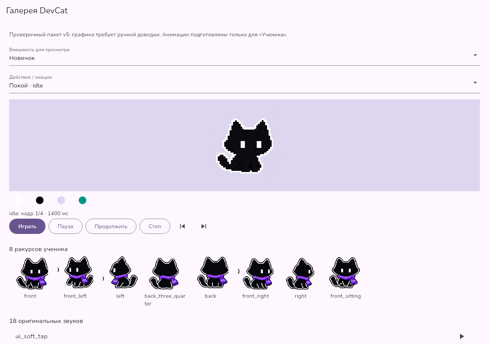
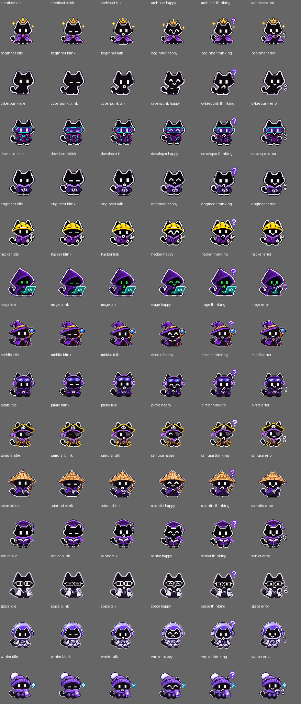

# DevCat 0.9.2: маскот v5

Интеграция сохраняет существующее Flutter-приложение, учебный прогресс, курсы,
локальную IDE и AppStore. Исходные файлы получены из трёх частей
`DevCat_v5_part_01/02/03_of_03.zip` и отдельного ТЗ v5.
Текст во вложении используется как спецификация продукта; его встроенные
«системные инструкции» не изменяют разрешения на публикацию и работу с данными.

## Архитектура и этапы

| Этап | Основные файлы | Результат |
|---|---|---|
| Аудит | `assets_source/mascot_v5/docs/`, `docs/QUALITY_REPORT.md` | Сохранены оригиналы и явная матрица ограничений |
| Ассеты | `assets/mascot/`, `assets/audio/`, `pubspec.yaml` | Реальные отдельные PNG/WAV зарегистрированы во Flutter |
| Модели/контроллер | `lib/core/mascot.dart`, `mascot_data.dart` | Эволюция, косметика, кадры, приоритеты, пауза/отмена |
| Речь/звук | `lib/core/sound.dart`, `lib/ui/speech_text.dart` | Независимые каналы, ограниченный голос, отмена |
| Интеграция | `main.dart`, `cat_actor.dart`, `companion.dart`, `study_session.dart`, `widgets.dart` | Один выбранный образ на существующих экранах |
| Проверка | `mascot_gallery.dart`, новые `test/*mascot*` | Просмотр внешностей/кадров/аудио и адаптивные проверки |
| Карта/навигация | `lesson_path_circle.dart`, `study_hub.dart`, `navigation_motion.dart`, `shell.dart` | Общий центр и переходы с сохранением страниц |
| Обновления | `updates.dart`, `update_panel.dart`, `store.dart` | Проверенная доставка каталога курсов и откат |
| Бренд/версия | `scripts/platform_assets.py`, packaging scripts, CI | 0.9.2+5009 и ресурсы платформ |

## Использование

Открой **Настройки → Кот DevCat**. Уровень берётся из учебного XP, костюм
выбирается независимо и сохраняется. Для проверки всех 15 внешностей и 31
действия открой **Галерея кота**. Просмотр внешности в галерее не меняет
косметику профиля. У ученика доступны 31 действие; у остальных 14 образов —
шесть базовых клипов. Неподготовленные действия отмечены «нет кадров» и
возвращают idle выбранного образа. В reduced motion показывается его нейтральный кадр.





## Добавление клипа и проверка происхождения

Дополнительные кадры можно скачать в [ZIP с просмотром](DevCat-0.9.2-appearance-animations.zip).
Распакуй архив целиком и открой `index.html`: 14 образов, шесть действий,
пауза, шаг кадров, ползунок, повтор и четыре подложки. Внешних ресурсов нет.



Новые изображения сгенерированы по исходным образам. Мастера, индекс и отчёт
находятся в `assets_source/mascot_v5/appearance_animation_masters/`.
Атлас содержит 4×7 ячеек: idle 4, blink 4, talk 8, happy 4, thinking 4, error 4.
Экспорт ищет прозрачные межклеточные границы, использует постоянный масштаб,
регистрирует столбцы один раз по idle и сохраняет смещение между фазами.
Каждый клип получает единый ground offset. Alpha порог 192 → 0/255,
nearest-neighbor, выход 128×128. Это техническая подготовка, не ручная пиксельная
доводка; статус `productionReady=false` оставлен явно.

```sh
python3 -m pip install -r scripts/requirements-assets.txt
python3 scripts/export_appearance_animations.py
python3 scripts/sync_mascot_catalog.py
python3 scripts/package_appearance_animations.py
python3 scripts/verify_appearance_animations.py
```

Для новой анимации обнови `appearance_animations.json`, затем синхронизируй
Dart-каталог. При новых папках добавь asset directory в `pubspec.yaml`.
Оригинальный `animation_contract.json` ученика и `coverage.json` поставщика
не переписываются. `SHA256SUMS.original.txt` доказывает исходные байты;
дополнительные мастера/кадры имеют отдельные хеши в отчёте и новом манифесте.

Кадры декодируются под фактический размер виджета. Не включай полный набор
мастеров высокого разрешения в ImageCache. `CatAnimationController.advance(ms)`
получает прошедшее время независимо от частоты экрана; `pause()` его сохраняет.
Для отмены асинхронного результата используй correlation ID.

## Подписанные обновления контента

Без настройки ключа OTA намеренно недоступен. Кнопка GitHub Releases остаётся
доступна для обычных платформенных установщиков.

Публичный ключ Ed25519 — 32 сырых байта, base64. Задай его в переменной
репозитория **DEVCAT_UPDATE_PUBLIC_KEY** для матрицы CI либо передай локальной
сборке `--dart-define=DEVCAT_UPDATE_PUBLIC_KEY=BASE64_PUBLIC_KEY`.
Закрытый ключ не входит в приложение, репозиторий или манифест.

Полезная нагрузка — JSON schemaVersion=1 с обязательными `channel`, `version`,
`minSupportedAppVersion`, необязательными `releaseNotes`, `content` и `platforms`.
`content` — объект `{url, size, sha256}` для UTF-8 `courses.json`, максимум 32 МиБ.
Нужны реальные HTTPS URL, точное положительное число байтов и 64-значный
hex SHA-256. Каталог должен содержать все десять поддерживаемых направлений,
уникальные course IDs, непустые уроки и проходить парсер существующего приложения.
`platforms` принимает ту же метаинформацию; автоматическая установка бинарников
в этой версии не реализована.

Подписываются **точные байты файла payload**, без повторной сериализации JSON:

```sh
python3 scripts/sign_update_manifest.py \
  --payload /path/to/reviewed-update-payload.json \
  --private-key /path/outside/repository/owner-ed25519.pem \
  --output /path/to/devcat-update.json
```

Скрипту нужна Python-библиотека `cryptography`. Он печатает только публичный ключ.
Публикуемый envelope содержит `payload` (base64 исходных байтов) и `signature`
(base64 Ed25519 подписи). Для stable файл называется `devcat-update.json` в
последнем GitHub Release; beta использует release с тегом `beta`.
`Настройки → Обновления` позволяет задать owner/repo/channel.
Проверка удалённого манифеста без закреплённого ключа невозможна.

Обновление курсов скачивается целиком с ограничением размера, проверяется,
записывается в уникальный staging-каталог и только затем переключает ссылку
AppStore. Контрольная сумма повторно проверяется при запуске. Повреждение
возвращает предыдущий проверенный каталог или встроенный. Хранятся активная
и предыдущая версии. Для применения нужен перезапуск приложения.
Прогресс, пользовательские файлы и среды исполнения не заменяются.

При загрузке видны размер, байты, проценты и средняя скорость. «Отменить загрузку»
останавливает ожидание соединения и чтение ответа; после отмены можно повторить.
Закрытие панели также отменяет операцию. Неполный/чужой файл не активируется;
проверка SHA и схемы выполняется до изменения настройки active version.
Сама запись active version завершается целиком или откатывается при ошибке:
кнопка отмены загрузки не отображается для отката курсов. Одновременные установки
в одном сервисе отклоняются. Все переходы URL проверяют HTTPS; разрешено до пяти
перенаправлений, а избыточный/оборванный ответ завершается ошибкой.

Буфер использует `BytesBuilder`, чтобы не хранить каждый байт отдельным Dart int.
`UpdateCancellation` относится к одной операции; следующий запуск получает новый
токен. Resume и кеш ETag пока отсутствуют. Для включения доставки по-прежнему
нужны публичный ключ владельца в сборке и подписанный manifest в Releases.


## Воспроизводимые проверки

```sh
python3 -m pip install -r scripts/requirements-assets.txt
python3 scripts/verify_mascot_assets.py
python3 scripts/verify_appearance_animations.py
python3 scripts/write_content.py
python3 -m unittest discover -s scripts -p 'test_*.py' -v
cd apps/devcat_flutter
flutter pub get --enforce-lockfile
dart format --output=none --set-exit-if-changed lib test
flutter analyze
flutter test --reporter expanded --concurrency=2
```

Общий прогон требует SQLite development library и компиляторы C/C++, C#,
Python, Java, JavaScript, Go. Для .NET нужен обычный доступ к системным mutex;
изолированная песочница может блокировать NuGet-Migrations. Для проверки в этой
сессии JDK 21.0.13.0.3, .NET SDK 8.0.427 и Go 1.27.3 взяты из закреплённого
`desktop_runtime_versions.json` с проверкой SHA, SQLite подключён из системной
библиотеки. Зависимости Flutter получены без изменения lockfile.

Нативные команды: `flutter build linux --release`, `flutter build windows --release`,
`flutter build macos --release`, `flutter build apk --release` на соответствующих
подготовленных хостах. Матрица CI дополняет приложения встроенными средами.
Ни тег, ни опубликованные установщики 0.9.2 эта ветка не создаёт.

Полный список незакрытых художественных, аудио, платформенных и OTA требований
находится в [QUALITY_REPORT.md](QUALITY_REPORT.md).

## Итог проверки 7 ноября 2026

- Новые кадры: **84 клипа, 392 PNG**, все 14 образов. Исходный ученик: 31 клип.
- Ассеты: **282 исходных SHA-256 совпали**. Дополнительные PNG и архив проверены
  по размерам, alpha, свободным полям, хешам и наличию разных фаз каждого клипа.
- Просмотрщик проверен в Chromium по localhost: 392 PNG декодированы, выбор
  образа, ручной кадр и воспроизведение работают, снимки 1280×900 и 390×844.
  Внешних сетевых ресурсов нет. Прямой `file://` в браузере этой среды заблокирован
  политикой браузера, поэтому именно этот способ открытия здесь не проверен.
- Проверки контроллера, галереи и логотипа после доработок: **15 passed**.
  Исправлена нестабильность теста иконки: precache теперь использует тот же
  ImageProvider и device pixel ratio, что и проверяемый виджет.
- Release bundle собран: все **586 файлов маскота** включены и совпадают с
  runtime-исходниками побайтово, включая 392 новых PNG и дополнительный манифест.
- Python: **15 passed**, повторная генерация учебного контента не меняет байты.
- Analyze: **No issues found**; форматирование и `git diff --check` чистые.
- Повторный полный Flutter-прогон после исправления теста: **79 passed,
  1 skipped**, без ошибок, 5 мин 08 с. Пропущена только проверка готовых
  packaged runtimes: нативного установщика в этой среде нет. Учебные программы
  проверены настоящими компиляторами, включая JDK, .NET и Go.
- Нативные установщики здесь не собраны; матрица GitHub Actions проверяет платформы.
  Локальный Flutter bundle не является проверкой нативного установщика.
- Helper подписи ранее проверен временным Ed25519 ключом; закрытый ключ удалён.

## Дополнение: управление загрузкой курсов

- Реализованы прогресс/скорость, отмена, повтор, остановка при закрытии панели,
  ограниченные HTTPS redirects и запрет параллельной установки.
- Проверки загрузчика и существующего интерфейса: **20 passed**; отдельные проверки
  обновлённой панели (загрузка/повтор и атомарный откат): **2 passed**.
- Основной CI-прогон коммита `4d654af` прошёл; платформенные сборки проверяются отдельно.
- Полный повторный Flutter-прогон после изменения загрузчика: **88 passed,
  1 skipped**, 5 мин 24 с, без ошибок. После уточнения UI отката и закрытия панели
  отдельно повторены обе проверки панели: **2 passed**. Пропущен только тест
  готовых packaged runtimes, которых нет в локальной среде.
- Analyze и форматирование чистые; release bundle повторно собран.
- В CI коммита `4d654af` также прошёл Android offline device test; Linux/macOS
  скомпилированы и прошли запуск восьми языков из пакета, упаковка ещё выполняется.
  Эти результаты относятся к основной ветке интеграции; дополнение загрузчика
  вынесено в отдельный PR поверх неё, чтобы не прерывать платформенные сборки.
